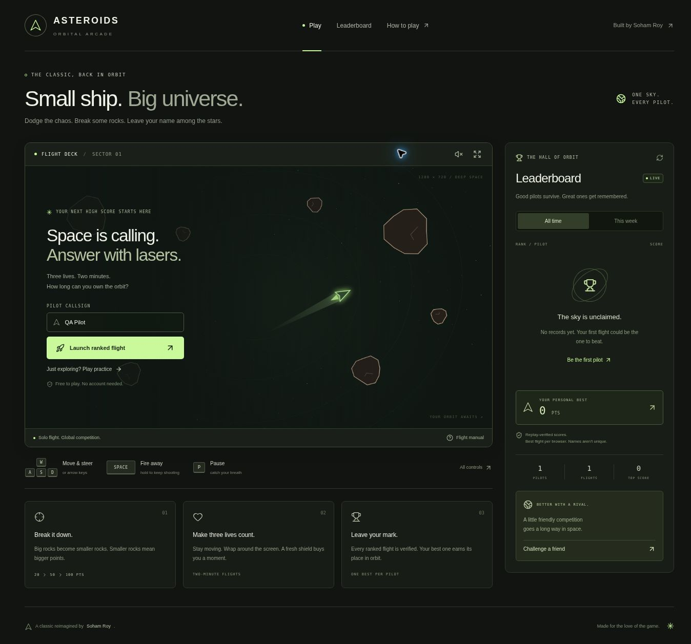

# Asteroids — Orbital Arcade

A browser edition of Soham Roy’s Python/Pygame Asteroids game. Pilot a ship, split asteroids, and compete on a persistent, replay-verified leaderboard.



## Play

- **Ranked flight:** choose a public callsign and launch. The server issues a seed and single-use flight credentials. The final score is calculated by replaying your controls on the server.
- **Practice:** play without a server connection. Scores are saved only as a device best, never as global records.
- Three lives; flights last up to two minutes. Big / medium / small asteroids award 20 / 50 / 100 points. Large and medium rocks split into two smaller rocks.
- WASD or arrows to steer and move, Space to fire, P or Escape to pause. Phone controls support simultaneous touch input. Rotate your phone for more space.
- Score ties favor the shorter flight, then the earlier completion. Weekly rankings cover the last seven days. Each browser pilot gets one best entry in each period.

## Stack and structure

React + TypeScript and Canvas 2D for the game. Vinext (Next.js-compatible routes) runs the API in a Cloudflare Worker. Cloudflare D1/SQLite stores flights and rankings; Drizzle maintains the schema and migrations. There are no paid asset, auth, or leaderboard API dependencies.

```
app/page.tsx                   Arcade interface, persistence and leaderboard
components/game/game-canvas.tsx Rendering, audio, keyboard and touch input
lib/game/engine.ts              Fixed-step seeded simulation shared by client and server
lib/game/replay.ts              Bounded recording validation and replay
app/api/runs/route.ts           Start flight; issue credentials and seed
app/api/runs/finish/route.ts    Verify recording and save score exactly once
app/api/leaderboard/route.ts    All-time/weekly leaderboard and personal best
db/schema.ts                  Flight records and indexes
drizzle/                      Generated migrations
tests/                        Engine, replay, and API/SQLite tests
```

## Run locally

Requires Node 24+ and pnpm 11.25.0 (the package manager version is pinned in package.json).

```sh
pnpm install --frozen-lockfile
pnpm run build
node --import ./scripts/sites-env.mjs ./node_modules/wrangler/bin/wrangler.js d1 execute DB --local --config dist/server/wrangler.json --persist-to .wrangler/state --filedrizzle/0000_equal_iceman.sql
pnpm run dev
```

Open the URL printed by the dev server. Apply the initial migration once per local database, then only new migrations as they are added. `pnpm run start` previews the built Worker. The database is local during development and is separate from hosted scores.

## Verify

```sh
pnpm run test
pnpm run typecheck
pnpm run build
# Start local preview first. This creates explicitly named local QA records:
node --experimental-strip-typestests/api-smoke.mjs http://127.0.0.1:5173
```

The API suite imports the actual route handlers with a local D1 adapter, runs production SQL against an in-memory SQLite database, and controls time for real-duration checks. It checks name validation, cross-origin rejection, credentials, impossible durations, malformed recordings, score calculation despite a forged score field, duplicate retries, expiry, pilot deduplication, and all-time/weekly queries. It never writes test scores to the hosted database.

## API

| Route | Method | Behavior |
| --- | --- | --- |
| `/api/runs` | POST | `{name}` → `{id, token, seed}` and an HttpOnly pilot cookie |
| `/api/runs/finish` | POST | `{id, token, frames, controls}` → server-derived `{score, frames, hits, saved}` |
| `/api/leaderboard?period=all` | GET | Top 20, your entry when outside top 20, aggregate stats and personal best |
| `/api/leaderboard?period=week` | GET | Same response for the last seven days |

Controls are an array of `[frame, bitmask]` changes: left=1, right=2, thrust=4, reverse=8, fire=16. The fixed 60 Hz simulation is independent of rendering speed. A failed score save can be retried and survives a page reload in the same tab using session storage.

## Persistence and integrity

- The database, not localStorage, is the source of truth for global scores.
- Pilot identity is a random HttpOnly, SameSite cookie. No login is required. Clearing cookies or changing browsers creates a new pilot; callsigns are public, nonunique labels.
- A random secret authorizes each flight; only its SHA-256 hash is stored. Finishing a flight also requires its pilot cookie.
- The server uses its own stored seed, validates the complete input recording, and derives score/hits/duration. It rejects recordings beyond two minutes or ahead of elapsed real time (with a three-second transport tolerance).
- Conditional updates prevent duplicate scores on retries. Queries are parameterized, names are validated and rendered as text, and writes reject cross-site browser origins.
- Start requests have a basic 60-flight/hour limit per browser or daily IP pseudonym. Expired unfinished flights are pruned. Concurrent requests can exceed this soft limit; use an edge rate limiter for hostile traffic.
- This is an educational competitive arcade, not a tournament security system. Valid automated play and new-cookie identities are possible. There is no account identity, name reservation, moderation dashboard, or live multiplayer.
- Raw IP addresses and emails are not stored. Daily IP hashes support abuse checks. Completed public scores and pseudonymous pilot IDs remain in the leaderboard database.

## Deployment and submission

The tracked `.openai/hosting.json` declares a `DB` D1 binding. Sites provisions storage and applies the generated migrations when deploying the saved source version. No secrets are committed. Another Cloudflare setup must configure the same binding and apply migrations before serving the Worker.

For a project demonstration: introduce the original Pygame version, show the browser port, launch a ranked flight, demonstrate splitting and pause, end the flight, show the verified leaderboard entry, and explain the shared deterministic engine. Include the deployed URL and this repository in the submission. Confirm the course rubric accepts this stack; this browser version is not MERN.

Public credit: **Soham Roy**. The maintained starter build tooling and its license notices are retained. The original desktop source lives at the repository root; this browser edition lives in `web/` when added to that repository.
